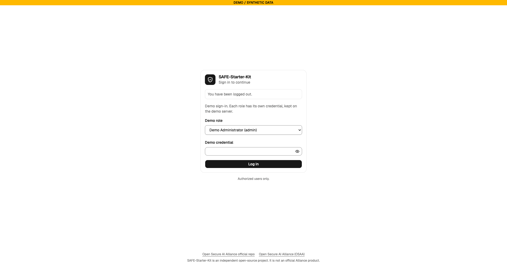

# Quick start

This page takes you from a clean machine to a signed-in administrator. Every command except `git clone` is taken from the README, from `scripts/` or from `compose.yaml`. Run them from the root of the repository. The stack is for local use only, with a development certificate.

## Before you start


- Docker with Compose v2. Check it with `docker compose version`.
- Git, to get the repository from https://github.com/Theseus-Guard/osaa-safe-starter-kit.
- Port 8443 on `127.0.0.1` must be free. Only one stack can use it at a time.

## Steps

1. Get the repository and enter it.

   ```sh
   git clone https://github.com/Theseus-Guard/osaa-safe-starter-kit.git
   cd osaa-safe-starter-kit
   ```

2. Generate the local secrets. The script creates the files in `secrets/` once and never overwrites them. `secrets/` is git-ignored and must stay out of the repository.

   ```sh
   ./scripts/init-secrets.sh
   ```

3. Create the development certificate. The script creates a local certificate authority and a server certificate in `secrets/tls`. It needs `openssl`.

   ```sh
   sh scripts/make-dev-cert.sh
   ```

4. Start the stack. The first start builds the images.

   ```sh
   docker compose up -d --build --wait
   ```

5. Trust the local certificate authority, or accept the browser warning. The authority is `secrets/tls/ca.crt`. See [gateway/README-TLS.md](../../gateway/README-TLS.md).

6. Create the first administrator. This works once: the command is refused when an administrator already exists. The password is read from standard input and must be at least 12 characters.

   ```sh
   printf '%s' '<choose a password>' | docker compose run --rm -T --no-deps api \
     python -m safe_kit.admin create-user --username <name> --role admin --email <address>
   ```

   The README shows this command without `--email`. Without that option the command reads the email from the second line of standard input. The README form stops with `email is required`, so pass `--email` as shown here.

7. Open https://127.0.0.1:8443 and sign in with the username and password from step 6.

   

   > **Known issue: demo sign-in on this stack.** `compose.yaml` runs the `api` and `worker` services with `SAFE_MODE=demo` and `SAFE_DATASET=synthetic-demo`. In that mode the sign-in page offers demo sign-in only. It lists the demo roles and asks for their demo credentials (see [Demo](./demo.md)). The account from step 6 is not a demo role, so that form does not accept it. This is taken from the code. It has not been run live for this guide.

8. Change the password when the application asks. A new account must change its password at its first sign-in. A new password must be at least 12 characters, must not match one of the last three passwords, and expires after 180 days.

9. Choose the system timezone when the application asks. The timezone sets how every time is shown. Stored times stay in UTC.

10. You are now on the Overview. Continue with the Users page to create the other accounts. See [Screens](./screens.md).

## Optional: check the container CLI

```sh
docker compose --profile cli run --rm cli health
```

## Sessions

An access token lasts 60 minutes. The session ends after 60 minutes without activity, and in any case 12 hours after the sign-in. These values come from `compose.yaml`.
