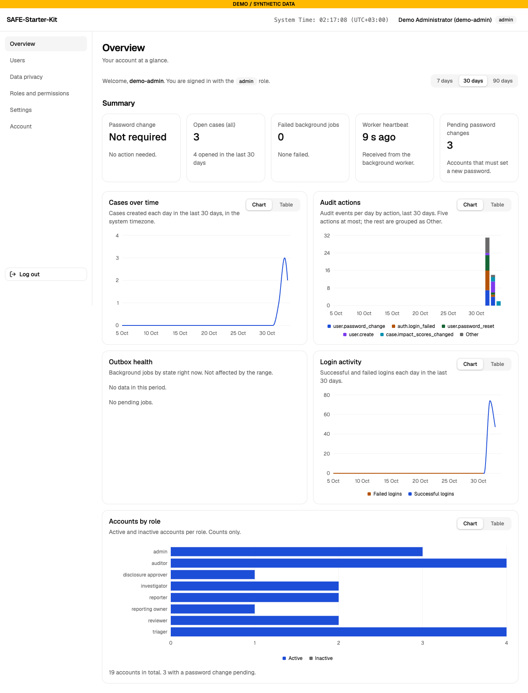
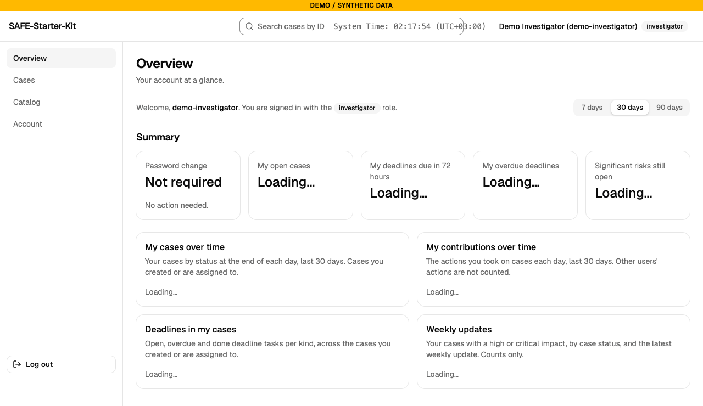
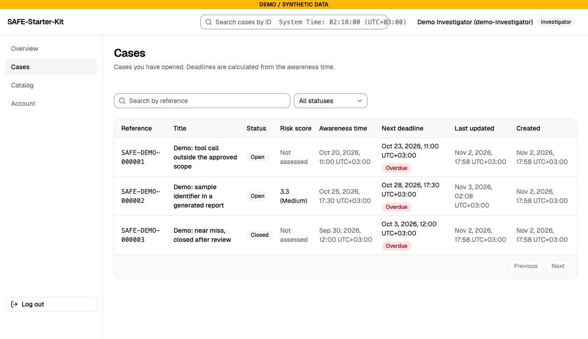
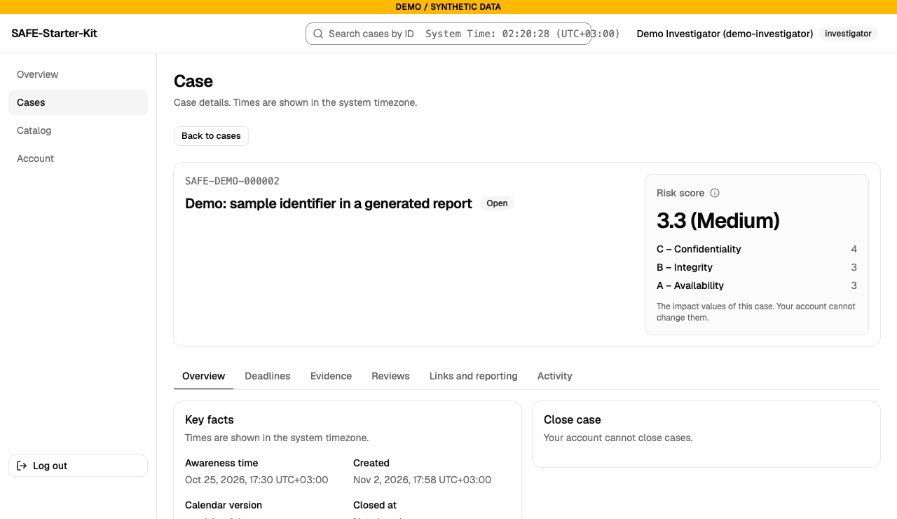
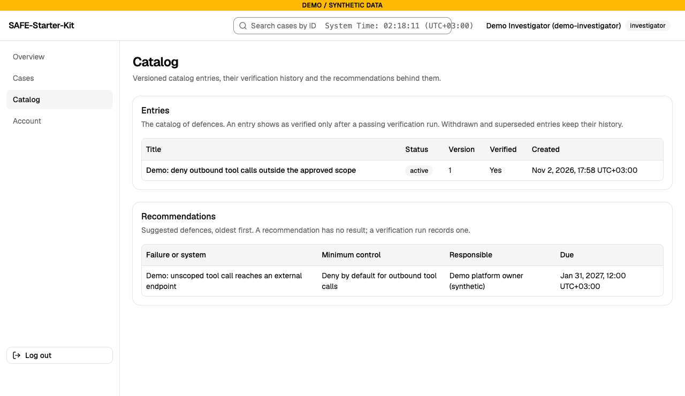
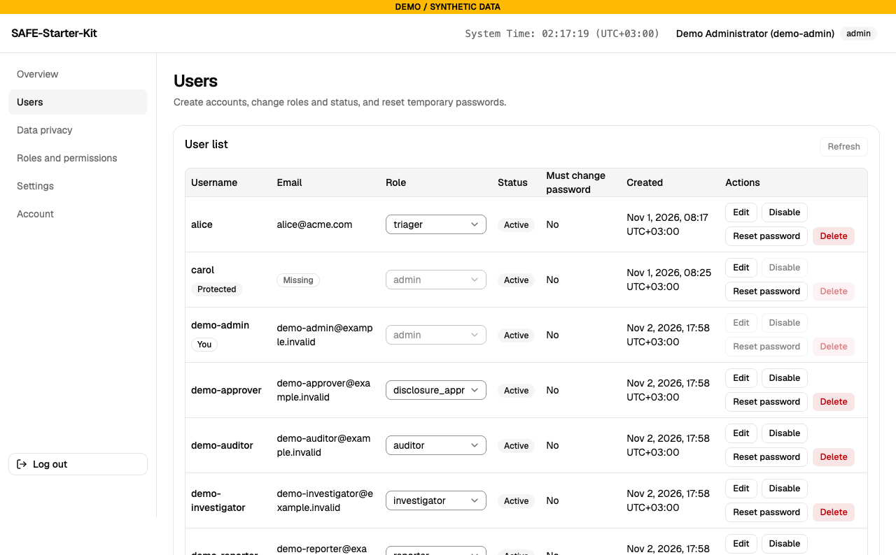
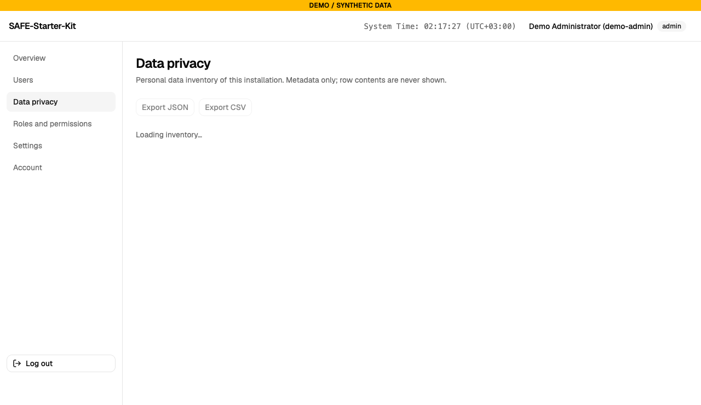
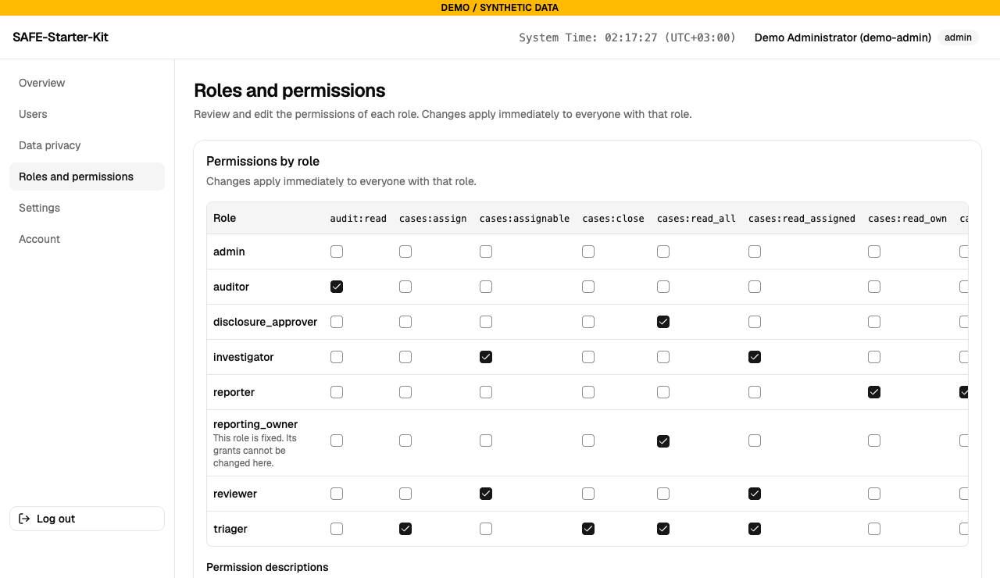
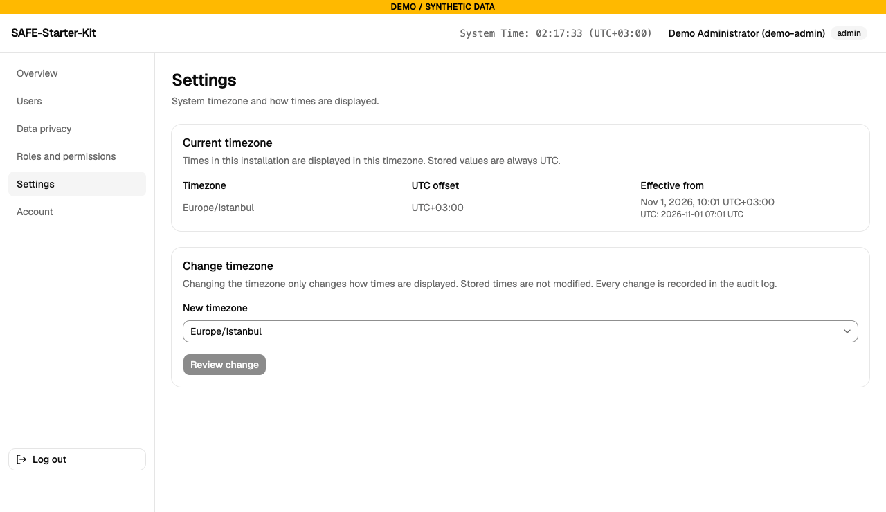
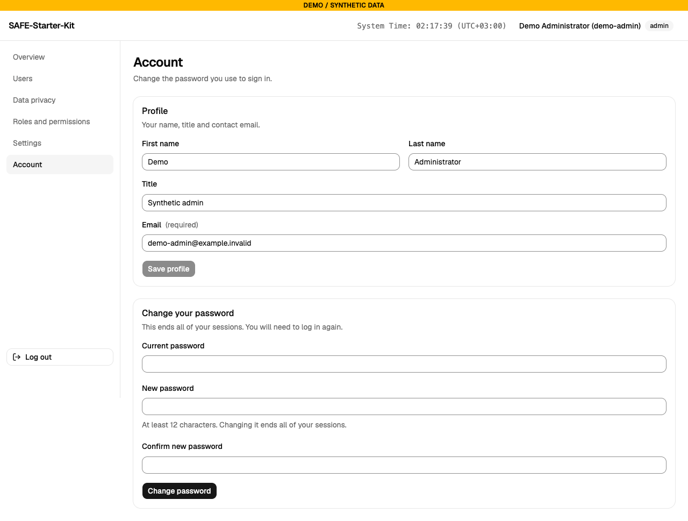

# Screens

This page describes each screen as the application shows it. Labels are the ones on the screen. "Who can change it" names the default roles of the [permissions table](./index.md#who-uses-it). Every change is checked again by the server, and the screen only hides or disables what the role cannot do.

Every signed-in page has the navigation, a search box for cases (for roles that can read cases), the system clock and the user menu. The user menu has the log out action and the appearance setting: Light, Dark or System.

## Sign-in

The sign-in page asks for a username and password. In demo mode it asks for a demo role and its demo credential instead (see [Demo](./demo.md)). A session lasts 60 minutes without activity and at most 12 hours from the sign-in.

## Overview

The investigator's Overview shows the same cards for the cases that account opened or is assigned to:

Shown to every signed-in user. The cards and charts depend on the role. Users with none of these sections see "Your role has no overview sections."

The **Date range** control offers 7, 30 and 90 days. The default is 30 days. It changes the "opened in the last N days" figures and the charts over time. The cards and charts show counts only, with no case titles and no user names. The only name shown is your own username in the welcome line.

| Section (who sees it) | Cards | Charts |
|---|---|---|
| Password change (everyone) | Password change: Required or Not required | |
| Own cases (reporter, triager, investigator, reviewer) | My open cases; My deadlines due in 72 hours; My overdue deadlines | My cases over time (open and closed cases you created or are assigned to); My contributions over time (cases you opened, assignments you added, reviews, cases you closed); Deadlines in my cases |
| Operations (auditor, admin) | Open cases (all); Failed background jobs; Worker heartbeat | Cases over time; Audit actions (top five per day, the rest as Other); Outbox health |
| Users (admin) | Pending password changes | Accounts by role; Login activity |
| Approvals (disclosure approver) | Versions awaiting approval; Oldest waiting version | Pending approvals |
| Weekly updates (investigator, reviewer) | Significant risks still open | Weekly updates |

What the cards count:

- **My open cases**: open cases you created or are assigned to.
- **My deadlines due in 72 hours**: open deadline tasks on your open cases that fall due in the next 72 hours.
- **My overdue deadlines**: open deadline tasks on your open cases whose due time has passed.
- **Failed background jobs**: background jobs that used up their retries.
- **Worker heartbeat**: the time since the worker last reported. It is shown as stale when the last report is more than 60 seconds old.
- **Versions awaiting approval**: the latest disclosure version of each package that has no approval.

## Cases

Shown to roles with a case read permission. The administrator and auditor roles see a message instead of the list.

- **New case** (only with the permission to submit cases, which the reporter role has). The dialog asks for a **Title**, the **Awareness date and time** in the system timezone, and an optional **Contact for follow-up**. The case is created with the deadlines calculated from that time.
- **Search by reference**: matches part of the case reference or of the case ID. The search starts after a short pause in typing and returns to the first page.
- **Status filter**: All statuses, Open or Closed.
- **Table**: Reference (a link to the case), Title, Status, Risk score (the value and its level, or "Not assessed"), Awareness time, Next deadline (with an **Overdue** badge when it has passed), Last updated, Created.
- **Previous** and **Next** page through the list, 20 cases at a time.

The header search box finds a case by reference or ID from any page.

## Case detail

Opened from a case reference. The header shows the reference, the title, the status and the risk score. **Edit impact values** changes the impact values (C, B and A); each save stores a new version and keeps the earlier ones. A closed case is read only: every change is disabled.

The tabs are listed below in the order the screen shows them. The **Evidence** tab appears only for roles that can read or write evidence. The **Disclosure** tab appears only for roles that can read disclosures. Inside **Links and reporting**, the reporter contact appears only for the reporting owner, and the preliminary report only for roles that can read the full case.

### Overview tab

Shows **Key facts** (awareness time, created, calendar version and closed time), **Close case** or **Reopen case**, **Assignments**, **Impacts** and **Classification**.

- Who can change it: closing and reopening need `cases:close` (triager). Adding and removing assignments needs `cases:assign` (triager). The assignee must be an active investigator or reviewer. Impacts and classification need `cases:triage` (triager).
- Closing needs a reason. The case cannot be closed until at least one review layer has an outcome, every deadline task is done or not applicable, and no external notice is left without a receipt and a follow-up (see [Workflows](./workflows.md)).
- Audited: `case.closed`, `case.reopened`, `case.assignment_added`, `case.assignment_removed`, `case.impact_changed`, `case.impact_scores_changed`, `case.classification_changed`.

### Deadlines tab

Shows the **Deadline tasks** of the case (status, due time, reason), the **Awareness events** and the **Legal duties**.

- Who can change it: setting a task to done or open needs `cases:read_all` or `cases:read_assigned`. The disclosure approver is refused this. Marking a task not applicable, and restoring it, needs `cases:triage` (triager). Recording or changing awareness events and legal duties needs `cases:triage`.
- An awareness event cannot be edited or removed once it is recorded.
- Audited: `case.deadline_updated` (with the old and new status), `case.awareness_recorded`, `case.legal_duty_added`, `case.legal_duty_changed`.

### Evidence tab

Lists the evidence of the case with its status (Pending, Available or Failed) and the upload date. For each item: **Download**, **Details** and **Custody**. **Upload** accepts PDF, PNG, JPEG, plain text and JSON. **Make a redacted copy** creates a redacted copy of a text original.

- Who can change it: reading and downloading needs `evidence:read`. Uploading needs `evidence:write` (investigator by default). A redacted copy needs both.
- The custody log records each upload, download and integrity check.
- Audited: `evidence.uploaded`, `evidence.downloaded`, `evidence.redacted`.

### Reviews tab

Shows the review rounds of the case. A round has eleven layers, and each layer has an outcome: Pass, Fail, Insufficient evidence or Not applicable. The **Review** section also shows **Conflicts**, **Recusals** and **Appeals**.

- Who can change it: opening a round and saving a layer need `reviews:write` and an active assignment to the case. Declaring a conflict and withdrawing (**Withdraw and name replacement**) need `reviews:write`. **File appeal** is open to every role that can read the case, except the disclosure approver. Every reader sees the rounds.
- A reason is required for every outcome except Pass. A Pass needs at least one evidence item of the same case.
- Saving a layer checks the revision that was read. A stale save is refused and nothing changes.
- Audited: `case.review_round_opened`, `case.review_layer_set`, `case.review_conflict_recorded`, `case.review_recusal_recorded`, `case.review_appeal_recorded`.

### Links and reporting tab

Shows **Linked cases**, the **Reporter contact** and the **Preliminary report**.

- **Link case**: links this case to another case by its ID. Needs `cases:triage`.
- **Show reporter contact** (reporting owner only): shows the follow-up contact the reporter gave. It is read only when the user clicks the button. The contact can be read while the case is open, and for 72 hours after it was closed. Every read is audited.
- **Preliminary report** (roles that can read the full case): the awareness, classification, impact, legal duty, deadline and missing-field sections of the case.
- Audited: `case.link_added`, `case.link_removed`, `reporter_contact.read`.

### Disclosure tab

Shows the disclosure package versions of the case, each with its preview. For the selected version it offers **Approve this version**, the external notices of that version, and **Export JSON** for an approved version.

- Who can change it: reading versions, previews and exports needs `disclosures:read` (triager and disclosure approver by default). **Approve this version** needs `disclosures:approve`. The form asks for the recipient, the approved recipient reference, the purpose and the digest. Type the digest exactly as the preview shows it. A preparer cannot approve a version they prepared.
- **Record notice** needs `disclosures:approve`. Without it, the role needs `disclosures:prepare` and must give a reason: the notice is then recorded on the manual path. The recipient reference of the notice must match the approved one.
- The notice actions are **Record receipt**, **Mark follow-up**, **Complete follow-up** and **Cancel notice**.
- Creating a disclosure version has no button on this screen. It is done through the API (see [Workflows](./workflows.md)).
- The application does not send anything. A notice records a send that a person made.
- Audited: `disclosure.approved`, `disclosure.exported`, `disclosure.notice_recorded`, `disclosure.notice_state_changed`, `disclosure.release_refused`.

### Activity tab

Shows the **History** of the case: the actions, their times and, where the role has full access, the actor and the details. Without full access (`cases:read_all`), the actor and the details show as Restricted. **Previous** and **Next** page through it. This tab is read only.

## Catalog

Shown to roles with `catalog:read` (triager, investigator, reviewer and auditor by default). The catalog list has two sections: **Entries** and **Recommendations**. Each has a **Load more** button when more rows exist.

- An entry shows as verified only after a passing verification run.
- Withdrawn and superseded entries keep their history.
- **New catalog entry** and **New recommendation** need `catalog:write` (reviewer by default).

The entry page shows the title, the verified state, the last check, the **Version history** (every version is kept) and the **Verification history**. A restricted reference and its digest are shown only to the `catalog:read_restricted` permission, which no default role has.

For a writer, the entry page offers **Save version**, **Save correction**, **Record dispute**, **Withdraw entry**, **Supersede the entry** and **Record a verification run**. All of them need `catalog:write`.

Audited: `catalog.entry_created`, `catalog.entry_versioned`, `catalog.entry_corrected`, `catalog.entry_disputed`, `catalog.entry_withdrawn`, `catalog.entry_superseded`, `catalog.recommendation_added`, `catalog.verification_recorded`, `catalog.exported` (for the catalog export made through the API or the CLI).

## Users

Admin only.

- **User list**: Username, Must change password, Status (Active or Disabled) and a Protected badge for protected accounts.
- **Create user**: Username, Email, First name, Last name, Title, Role and Temporary password. The new account must change its password at the first sign-in.
- Per user: **Edit** (profile), **Enable** or **Disable**, **Reset password** (sets a temporary password and ends the user's sessions), and **Delete**. Delete deactivates the account and hides it from the list. The record is kept.
- You cannot change your own role or status. Protected accounts keep their role and status.

Audited: `user.create`, `user.update`, `user.profile_updated`, `user.password_reset`, `user.delete`.

## Data privacy

Admin only. It shows the personal data inventory of the installation: each table with its description and retention period. The retention periods are provisional and await legal review. The page shows metadata only, never row contents. **Export JSON** and **Export CSV** download the inventory. **Previous** and **Next** page through the tables.

## Roles and permissions

Admin only. It shows a grid of roles and permissions. Each role has a **Save** button, and a saved change applies at once to everyone with that role.

- The three permissions of the admin role are checked and locked.
- The `reporting_owner` row is read only.
- The reporter contact permission cannot be granted to any role.

Audited: `role.permissions_change`, with the granted and revoked permissions.

## Settings

Admin only.

- **Current timezone** shows the timezone of the installation. Stored times are always UTC.
- **Change timezone** picks a new timezone after a confirmation. Changing it changes only how times are shown.

Audited: `system.timezone_set` and `system.timezone_changed`.

## Account

Shown to every signed-in user.

- **Profile**: first name, last name, title and email. An email cannot be cleared.
- **Change your password**: needs the current password. The change ends all your sessions, and you sign in again.

Audited: `user.password_change`, `user.profile_updated`.
